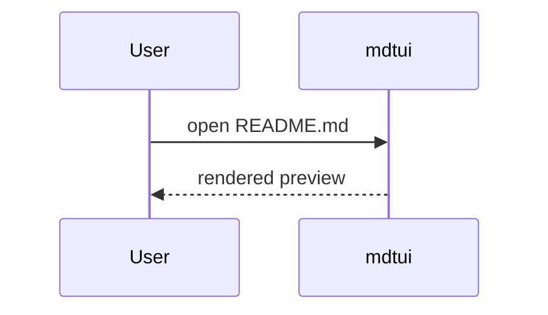
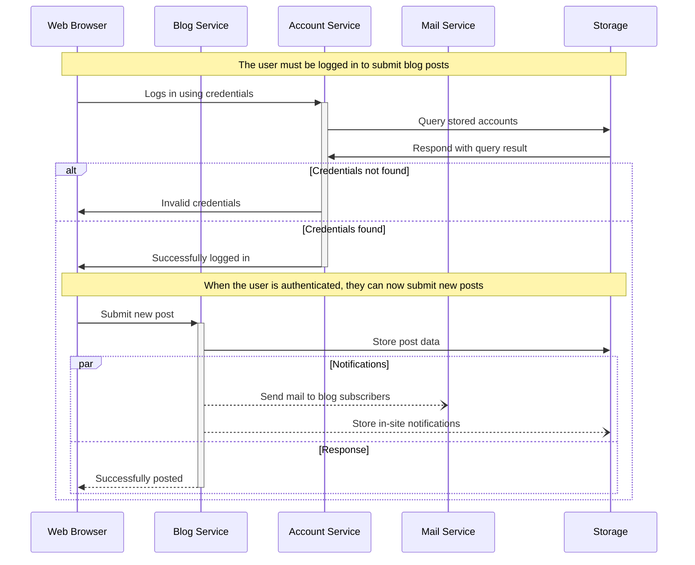
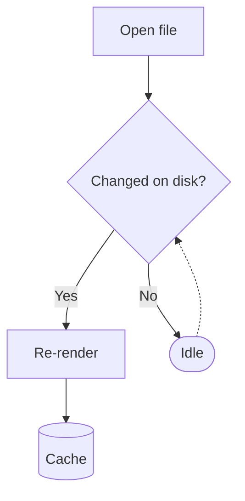
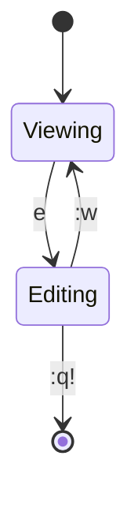
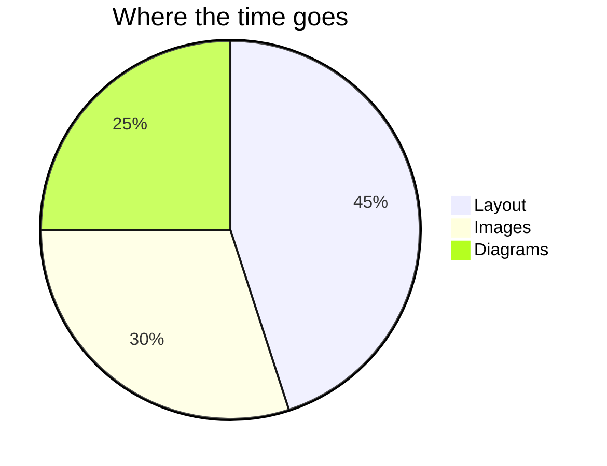

# mdtui Kitchen Sink

A **fast** terminal markdown viewer with `vim` keys, *mouse support*, ~~no~~ live reload,
==highlights==, emoji shortcodes :rocket: :sparkles:, and [links](https://github.com/ratatui/ratatui).
Jump to [the tasks](#tasks) or open [another file](./plugins/README.md).

## Contents

- [Text](#text)
- [Tasks](#tasks)
- [Code](#code)
- [Tables](#tables)
- [Alerts](#alerts)
- [Images](#images)
- [Diagrams](#diagrams)
- [Math](#math)

## Text

Paragraphs wrap to the window width. Soft line breaks
join lines; a trailing backslash forces a hard\
break. Inline `code`, **bold**, *italic*, ***both***, ~~strike~~ and
autolinks like https://example.com all work. Footnotes too.[^speed]

> Block quotes render with a bar.
>
> > And they nest.

### Lists

1. First
2. Second
   - nested bullet
   - another
     - third level
3. Third

Term
: Description lists are supported as well.

## Tasks

- [x] Parse GFM with comrak
- [x] Render tables, alerts and footnotes
- [x] Render mermaid diagrams
- [ ] Lua plugins
  - [ ] nested task
	- [ ] another task

## Code

```rust
use std::collections::HashMap;

/// Count words in a document.
fn word_count(text: &str) -> HashMap<&str, usize> {
    let mut counts = HashMap::new();
    for word in text.split_whitespace() {
        *counts.entry(word).or_insert(0) += 1;
    }
    counts
}
```

```python
def fib(n: int) -> int:
    return n if n < 2 else fib(n - 1) + fib(n - 2)
```

```
plain fenced block with no language and a very long line that should wrap inside the box rather than overflow the terminal width
```

## Tables

| Feature     | Status  | Score |
|:------------|:-------:|------:|
| Markdown    | done    |    10 |
| Images      | done    |     9 |
| **Mermaid** | via mmdc |    8 |
| Plugins     | Lua 5.4 |   `∞` |

## Alerts

> [!NOTE]
> Alerts render with an icon and a colour bar.

> [!TIP]
> Press `?` for help.

> [!IMPORTANT]
> Checkbox clicks write back to the file.

> [!WARNING]
> Mermaid needs `mmdc` (or `mermaid-ascii`) on your PATH.

> [!CAUTION]
> Untrusted plugins can't run programs.

## Images


 

<p align="center"></p>

## Diagrams












## Math

Inline math like $e^{i\pi} + 1 = 0$ and $\alpha^2 + \beta_1 \le \infty$.

$$
\sum_{i=1}^{n} i = \frac{n(n+1)}{2}
$$

---

<details>
<summary>HTML details</summary>

Raw HTML is shown as text.

</details>

[^speed]: Layout is cached per width; images decode on worker threads.
